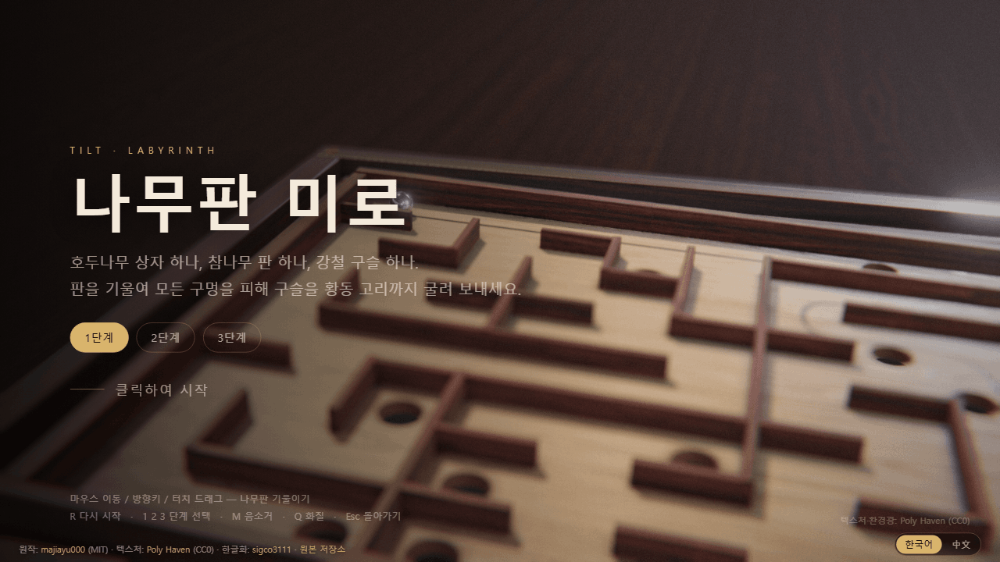
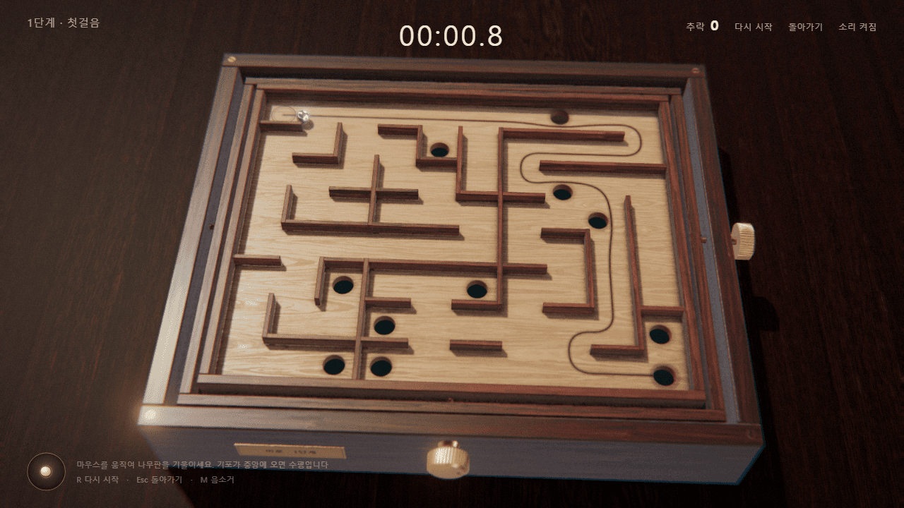
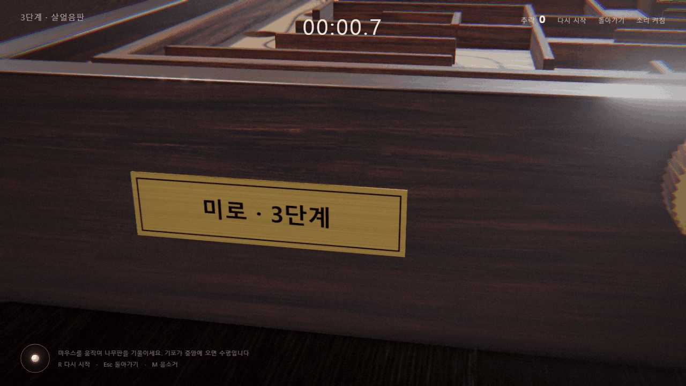
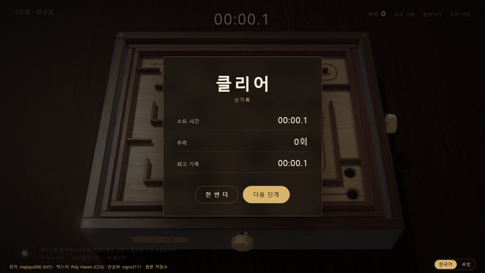

<div align="center">

# 나무판 미로 · Tilt Labyrinth 木盘迷宫 한글화

**호두나무 상자 속 참나무 판 위에서 강철 구슬을 굴려, 구멍을 피해 황동 고리까지 보내는 3단계 3D 미로 게임**

[](https://sigco3111.github.io/tilt-labyrinth-ko/)
[](LICENSE)
[](https://threejs.org/)

**플레이: https://sigco3111.github.io/tilt-labyrinth-ko/**

</div>

---

## 프로젝트 소개

### 무엇인가요?

**Tilt Labyrinth 木盘迷宫**(원작: [majiayu000](https://github.com/majiayu000))은 마우스·키보드·터치로 나무판을 기울여 강철 구슬을 굴리는 브라우저용 3D 미로 게임입니다. 판 위의 구멍(어두운 원)에 빠지면 구슬이 출발점으로 돌아가고, 구슬을 황동 고리까지 보내면 클리어입니다. 이 저장소는 원작의 화면 문구를 **한국어로 옮긴 비공식 한글화 버전**입니다.

### 왜 만들었나요?

원작은 모든 화면 문구(타이틀, 단계 이름, 조작 안내, HUD, 클리어 화면, 3D 명판)가 중국어로만 되어 있어 한국어 사용자가 조작법과 규칙을 읽기 어렵습니다. 게임 로직·렌더링·소리·텍스처는 그대로 두고 문구만 한국어로 바꿔, 설치 없이 한국어로 바로 즐길 수 있게 했습니다.

### 누구를 위한 것인가요?

- 짧게 즐길 수 있는 3D 퍼즐·미로 게임을 브라우저에서 바로 해 보고 싶은 한국어 사용자
- 마우스를 움직이는 것만으로 조작하는 가벼운 게임을 찾는 사람
- 번들(빌드 결과물)로만 배포된 게임을 소스 재빌드 없이 한글화한 방식이 궁금한 사람 ([한글화 내용](#한글화-내용) 참고)

## 주요 기능

- **3단계 미로**: 1단계 · 첫걸음 / 2단계 · 숨죽이며 / 3단계 · 살얼음판. 타이틀 화면의 `1단계` `2단계` `3단계` 버튼이나 숫자키 `1` `2` `3`으로 고릅니다.
- **실제 같은 3D 장면**: 호두나무 상자, 참나무 판, 황동 손잡이, 강철 구슬, 상자 앞면의 황동 명판(한국어 글자가 그려짐).
- **다양한 입력**: 마우스 이동, 방향키·`W` `A` `S` `D`, 터치 드래그로 나무판을 기울입니다.
- **HUD**: 단계 이름, 경과 시간(`분:초.0`), 추락 횟수, 판의 수평을 보여주는 기포 수준기, `다시 시작` · `돌아가기` · `소리 켜짐/꺼짐` 버튼.
- **기록 저장**: 클리어하면 소요 시간·추락 횟수·단계별 최고 기록이 표시되고, 최고 기록은 브라우저에 저장됩니다(`신기록` 표시).
- **효과음**: 구슬이 구르고 부딪히고 떨어지고 고리에 들어가는 소리가 나며, `M` 키나 버튼으로 끌 수 있습니다.
- **화질 전환**: `Q` 키로 `표준` ↔ `높음`을 바꿉니다.
- **한국어 / 中文 전환**: 오른쪽 아래 스위치와 `?lang=ko` · `?lang=zh` 주소 매개변수로 언어를 바꿉니다.
- **설치 불필요**: 정적 파일만으로 동작하며, 실행 중 외부 서버로 요청하지 않습니다.

## 실행 화면

모든 화면은 배포된 라이브 사이트(<https://sigco3111.github.io/tilt-labyrinth-ko/>, 한국어 모드, 1280×720)에서 직접 캡처했습니다.

<table>
  <tr>
    <td align="center" width="50%">
      
      <br><sub><b>타이틀 화면</b> — 단계 선택, 조작 안내, 언어 스위치와 크레딧 줄</sub>
    </td>
    <td align="center" width="50%">
      
      <br><sub><b>1단계 플레이</b> — 나무판 위의 강철 구슬과 한국어 HUD(시간·추락·버튼·수준기)</sub>
    </td>
  </tr>
  <tr>
    <td align="center" width="50%">
      
      <br><sub><b>3D 명판</b> — 상자 앞면의 명판에 한국어 글자가 그려집니다(3단계, 설명용으로 카메라를 가까이 옮겨 캡처)</sub>
    </td>
    <td align="center" width="50%">
      
      <br><sub><b>클리어 카드</b> — 소요 시간·추락·최고 기록과 ‘한 번 더’ / ‘다음 단계’ 버튼(설명용으로 구슬을 고리 옆에 두어 클리어, 시간 수치는 의미 없음)</sub>
    </td>
  </tr>
</table>

## 설치·실행 방법

### 온라인에서 바로 플레이

<https://sigco3111.github.io/tilt-labyrinth-ko/> 에 접속하면 됩니다.

- 약 11.8 MB(11,802,005바이트)의 스크립트에 텍스처가 포함되어 있어 처음 열 때 불러오기에 시간이 걸립니다(불러오는 동안 `나무판을 올려놓는 중` 표시).
- **WebGL2를 지원하는 브라우저**가 필요합니다. 게임은 WebGL2 컨텍스트만 요청하며, 생성에 실패하면 `불러오기 실패: …` 문구가 표시됩니다.
- 브라우저 언어가 한국어(`ko`)이면 한국어로 시작합니다. 그 외 언어는 원문(중국어)으로 시작하므로 오른쪽 아래 `한국어` 버튼을 누르거나 `?lang=ko`를 붙이세요.

### 내 컴퓨터에서 실행

빌드 과정이 없고 정적 파일(`index.html`, `dist/game.js`)만 있으므로 아무 정적 웹 서버로 열면 됩니다. 아래 명령은 직접 실행해 확인했습니다(서버가 `/`와 `dist/game.js`를 HTTP 200으로 응답함).

```bash
git clone https://github.com/sigco3111/tilt-labyrinth-ko.git
cd tilt-labyrinth-ko
python3 -m http.server 8000
# 브라우저에서 http://localhost:8000/ 열기
```

### 조작법

| 입력 | 동작 |
|---|---|
| 마우스 이동 / 방향키 / `W` `A` `S` `D` / 터치 드래그 | 나무판 기울이기 |
| 클릭(타이틀 화면) / `Enter` / `Space` | 시작 (클리어 카드에서 `Enter` / `Space`는 다음 단계) |
| `R` (또는 HUD의 `다시 시작`) | 현재 단계를 처음부터 다시 시작 (시간·추락 횟수 초기화) |
| `1` `2` `3` | 단계 선택 (타이틀에서는 선택만, 플레이 중에는 해당 단계로 다시 시작) |
| `Q` | 화질 전환 (`화질: 표준` ↔ `화질: 높음 (더 선명하지만 GPU 부하 증가)` 알림) |
| `M` (또는 HUD의 소리 버튼) | 소리 켜짐 ↔ 꺼짐 |
| `Esc` (또는 HUD의 `돌아가기`) | 타이틀 화면으로 돌아가기 |

### 규칙

- **목표**: 판을 기울여 구슬을 황동 고리(목표 구멍)에 넣습니다. 총 3단계이며 3단계를 클리어하면 버튼이 `1단계로 돌아가기`로 바뀝니다.
- **추락**: 구슬이 일반 구멍에 빠지면 잠시 뒤 출발점으로 돌아가고 `추락` 횟수가 1 늘어납니다. 횟수는 클리어 카드에 `N회`로 표시됩니다.
- **시간**: 구슬이 굴러가는 동안에만 흐르며, 클리어 시 단계별 최고 기록과 비교됩니다.
- HUD 왼쪽 아래 수준기의 기포가 중앙에 오면 판이 수평입니다.

## 기술 내용

| 항목 | 내용 |
|---|---|
| 3D 엔진 | [three.js](https://threejs.org/) **r187** (번들에 포함, 렌더러에 `three.js r187` 표시), WebGL2 |
| 구성 | `index.html`(화면 마크업·스타일·언어 선택/번역 스크립트) + `dist/game.js`(미리 빌드된 게임 번들, 11,802,005바이트) |
| 빌드 | 없음 (빌드 결과물을 그대로 수정해 배포, 패키지 매니저·소스 코드 없음) |
| 렌더링 | 그림자 맵, GTAO(앰비언트 오클루전), 보케(피사계 심도), 블룸 후처리, 톤 매핑 사용. 프레임 시간이 길어지면 렌더 해상도를 자동으로 낮춥니다 |
| 물리 | 번들 내부의 자체 구현, 1/240초 고정 간격으로 갱신 |
| 텍스처 | JPEG 8장이 번들에 data URI로 내장되어 있고, 일부 텍스처는 캔버스로 생성 ([Poly Haven](https://polyhaven.com/) CC0) |
| 소리 | Web Audio API로 합성 (별도 오디오 파일 없음) |
| 글꼴 | 시스템 글꼴 사용 (웹 글꼴 파일 없음). 한국어는 `Noto Sans KR` / `Malgun Gothic` / `Apple SD Gothic Neo`, 제목·명판은 명조 계열 우선 |
| 저장 | 브라우저 `localStorage`: 언어 `tilt-labyrinth-ko.lang`(`ko` / `zh`), 단계별 최고 기록(초) `tilt-labyrinth-best-0` ~ `-2` (단계 1~3). 저장소를 쓸 수 없으면 최고 기록은 `—`로 표시 |
| 외부 요청 | 없음. 실제 실행 중 불러온 리소스는 `dist/game.js` 1건뿐이며(이미지·글꼴·API 요청 없음), 화면 아래 크레딧의 링크는 클릭할 때만 이동합니다 |
| 주소 매개변수 | `?lang=ko` / `?lang=zh` (언어 지정·저장). 코드에는 `?level=1~3`(시작 단계), `?play`(바로 시작), `?auto`(자동 플레이)도 있음 |

### 한글화 내용

- 타이틀·로딩 화면, 단계 이름(첫걸음 / 숨죽이며 / 살얼음판), 조작 안내(마우스·키보드·터치), HUD, 클리어 화면과 버튼, 화질 알림, 불러오기 실패 문구, 3D 명판에 그려지는 글자까지 한국어로 옮겼습니다. (번역 항목 **34개**: 페이지 마크업 `index.html` 22개, 게임 번들 `dist/game.js` 12개)
- 번들 안의 문자열은 해당 문자열 리터럴만 번역 함수 호출(`__tl("키")`)로 바꿨습니다. 셰이더 안의 중국어 주석은 화면에 표시되지 않아 그대로 두었습니다.
- **언어 전환**: 오른쪽 아래에 작은 `한국어` / `中文` 스위치를 추가했습니다. 누르면 선택이 저장되고 페이지가 다시 로드됩니다. 원문에는 영어 UI가 없어 영어는 추가하지 않았습니다.
- **기본 언어 규칙**: `?lang=` 주소 값 → 저장된 선택(`localStorage`) → `navigator.language`가 `ko`로 시작하면 한국어, 그 외에는 원문(중국어) 순으로 정해집니다.
- 한국어 모드에서는 한글 글꼴과 자간을 조정하는 CSS를 적용하고, 타이틀·로딩·클리어 화면 아래에 원작자·한글화 크레딧 줄을 표시합니다(플레이 중에는 숨김).
- 게임 로직, 렌더링, 오디오, 텍스처는 변경하지 않았습니다. 원본 빌드 결과물을 직접 수정했으며(재빌드 없음), 위 변경이 수정의 전부입니다.

### 확인 범위

이 문서의 동작 설명은 배포된 사이트에서 직접 조작해 확인했거나(마우스·방향키 기울이기, 시작, `R` `Esc` `1`~`3` `M` `Q` 키, 구멍 추락과 추락 횟수, 클리어 카드, 한국어/中文 전환) 코드(`index.html`, `dist/game.js`)에서 확인한 내용입니다. 터치 조작, 데스크톱에서의 포인터 잠금(시작 시 요청하고, 잠금이 풀리면 타이틀로 복귀), `?level` `?play` `?auto` 매개변수, WebGL2 미지원 환경의 오류 표시, 로컬 서버 주소에서의 브라우저 실행은 코드를 읽어서만 확인했거나 직접 실행해 보지 못했습니다.

## 라이선스·원작 표기

이 저장소는 [MIT License](LICENSE)로 배포되며, 원작의 라이선스 전문을 수정 없이 그대로 포함합니다.

### 원작 표기 및 고지 (Attribution / NOTICE)

- **원작**: Tilt Labyrinth 木盘迷宫 — 작성자 [majiayu000](https://github.com/majiayu000)
- **원본 저장소**: https://github.com/majiayu000/blog (`src/posts/tilt-labyrinth/play`, 원작자의 공개 플레이 페이지: https://blog.silencestar.com/posts/tilt-labyrinth/play/ )
- **사용한 원본 커밋**: 저장소 최신 `098c838ca8b64ffa03373073c5b294e0588b46fa` 기준. 해당 폴더를 마지막으로 수정한 커밋은 `2c90def72ebb3a160f21ea4623cda7a579c992ad`입니다.
  - 원본 `play/index.html`: 10,071 바이트, SHA-256 `ef17081e8f8e8cbc9bb7bd1b67bef5d1cd689483b8948b19f68b4b01c041e449`
  - 원본 `play/dist/game.js`: 11,802,315 바이트, SHA-256 `57209d5e29d15e197a810031986edb6e3aabd0e04ad6f8b0ddcc017f665d393b`
- **라이선스**: [MIT License](LICENSE), Copyright (c) 2026 majiayu000 — 원본 저장소의 `LICENSE`를 수정 없이 그대로 포함했습니다.
- **텍스처·환경광**: [Poly Haven](https://polyhaven.com/) (CC0 1.0, 퍼블릭 도메인 헌정). 원본 번들에 포함되어 있습니다.
- **변경 사항**: 원본에 (1) 한국어 번역, (2) 언어 전환 버튼과 언어 선택·번역 스크립트, (3) 한글 글꼴 및 레이아웃 CSS, (4) 크레딧 줄, (5) 문서 언어 속성과 페이지 제목 변경을 추가했습니다. 그 외 내용은 원본과 같습니다.
- 이 저장소는 원작자와 관련이 없는 비공식 한글화이며, 한글화 작업: [sigco3111](https://github.com/sigco3111)
- 스크린샷(`docs/screenshots/`)은 배포된 한글화 사이트를 직접 캡처한 것입니다.
